  

&nbsp;
&nbsp;
&nbsp;
&nbsp;

---

## About Me

I am a climate scientist and Ph.D. researcher at **Johns Hopkins University**. I study how droughts, floods and other climate extremes move through water, land and food, and what they mean for people's health and livelihoods, using satellites, hydrological models and statistics to follow that chain from orbit to the field.

Before the doctorate I spent nearly three years as a coastal and hydrodynamics project engineer in Jamaica, designing shoreline protection and flood mitigation for Caribbean climate-resilience projects worth up to **US $3 million** and serving more than **250,000 residents**. I am a licensed Professional Engineer.

<!-- STATS:START -->
&nbsp;
&nbsp;
&nbsp;
&nbsp;

 Google Scholar, November 2026 · <a href="https://scholar.google.com/citations?user=uck5WJAAAAAJ">verify</a>
<!-- STATS:END -->

---

## Research Domains

## Selected Publications

<!-- PUBS:START -->
- **Integrating artificial intelligence and machine learning in hydrological modeling for sustainable resource management.** *International Journal of River Basin Management* 24(5), 769-785 (2026). [Paper](https://doi.org/10.1080/15715124.2025.2478280)
- **SWAT and CMIP6-driven hydro-climate modeling of future flood risks and vegetation dynamics in the White Oak Bayou Watershed, United States.** *Earth Systems and Environment* 10(1), 553-575 (2026). [Paper](https://doi.org/10.1007/s41748-025-00621-2)
- **A systematic review of the NASA Land Information System (LIS): Two decades of advancements in hydrological modeling, data assimilation, and operational earth system applications.** *Journal of Hydrology* 666, 134784 (2026). [Paper](https://doi.org/10.1016/j.jhydrol.2025.134784)
- **The Climate and Land-Use Change Feedback in the Congo Basin.** *Resilience and Sustainability in the Congo Basin*, 839-861 (2026). [Chapter](https://doi.org/10.1007/978-1-0716-5512-2_32)
- **Relative roles of spatial resolution and temporal coverage in basin-average SMAP soil moisture assimilation over the Mekong River basin.** *Journal of Hydrology* 681, 136599 (2026). [Paper](https://doi.org/10.1016/j.jhydrol.2026.136599) · [Code](https://github.com/rushmarshall/mekong-swat-smap-enkf)
- **Assessment of Terrain Scenario Impacts on Hydrological Simulation with SWAT Model. Application to Lai Giang Catchment, Vietnam.** *Advances in Hydroinformatics*, 1205-1222 (2022). [Chapter](https://doi.org/10.1007/978-981-19-1600-7_77)
<!-- PUBS:END -->

---

## Technical Skills

<table>
<tr><td width="50%" valign="top"><strong>Programming Languages</strong>      </td><td width="50%" valign="top"><strong>Machine Learning &amp; Data Science</strong>       </td></tr>
<tr><td width="50%" valign="top"><strong>GIS &amp; Remote Sensing</strong>       </td><td width="50%" valign="top"><strong>Hydrological &amp; Coastal Modeling</strong>       </td></tr>
<tr><td width="50%" valign="top"><strong>Cloud &amp; DevOps</strong>     </td><td width="50%" valign="top"><strong>Databases</strong>   </td></tr>
</table>

---

## Recognition

<table>
  <tr><td></td><td><b>Rajagopalan Family Fellowship</b> Johns Hopkins University, Whiting School of Engineering</td></tr>
  <tr><td></td><td><b>Water Prediction Innovators Summer Institute Fellow</b> The University of Alabama and CUAHSI · one of 24 fellows nationally</td></tr>
  <tr><td></td><td><b>Winner, UVA Engineering Research Symposium</b> University of Virginia · one of four winners</td></tr>
  <tr><td></td><td><b>Erasmus Mundus Joint Master's Scholarship</b> European Union, EuroAquae+</td></tr>
  <tr><td></td><td><b>China Harbour Engineering Company Scholarship</b> One of 15 scholars worldwide</td></tr>
</table>

 ASCE · EWRI · AGU · AWWA · COPRI · JIE Jamaica

---

## Education

<table>
  <tr><td></td><td><b>Ph.D. research, Environmental Health and Engineering</b> Johns Hopkins University, Baltimore, MD</td></tr>
  <tr><td></td><td><b>Doctoral studies, Civil and Environmental Engineering</b> University of Virginia · GPA 4.0 / 4.0</td></tr>
  <tr><td></td><td><b>M.Sc. Hydroinformatics and Water Management</b> EuroAquae+ Erasmus Mundus Joint Master · France, United Kingdom, Germany</td></tr>
  <tr><td></td><td><b>B.Eng. Harbour, Waterway and Coastal Engineering</b> Hohai University, Nanjing, China · GPA 4.7 / 5.0</td></tr>
</table>

## Experience

<table>
  <tr><td></td><td><b>Graduate Research Assistant</b> Johns Hopkins University, Baltimore, MD</td></tr>
  <tr><td></td><td><b>Visiting Research Scientist</b> CIROH, The University of Alabama and CUAHSI</td></tr>
  <tr><td></td><td><b>Graduate Research Assistant</b> University of Virginia · funded in part by USACE</td></tr>
  <tr><td></td><td><b>Junior Coastal and Hydrodynamics Project Engineer</b> Smith Warner International, Jamaica</td></tr>
  <tr><td></td><td><b>Hydraulic / Smart Water Engineer Intern</b> SUEZ, Paris, France</td></tr>
  <tr><td></td><td><b>Lead Data and Geospatial Analyst</b> Smith Warner International, remote from France</td></tr>
</table>

---

## GitHub Activity

---

Open to collaborations on climate extremes, water, food and health.
  

  

